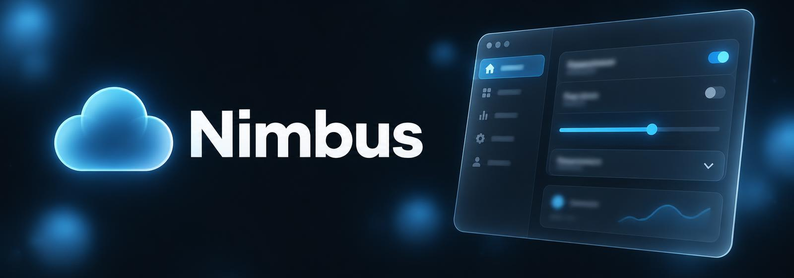
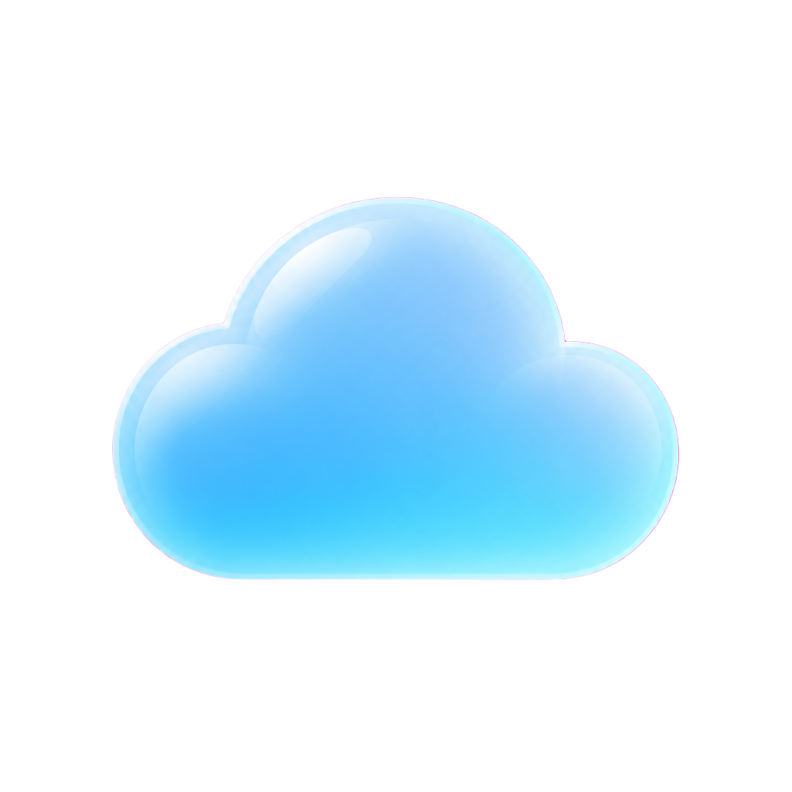

<p align="center"></p>

<p align="center"></p>

# Nimbus

Nimbus is a ui library for roblox that I made because I wanted a menu that looked kind of like frosted glass instead of the usual flat boxes. It has a sidebar for tabs, rounded everything, and it blurs the game behind it when you open it. It also has a search bar at the top that filters whatever tab you are on, which I thought was cool.

## Loading it

```lua
local Nimbus = loadstring(game:HttpGet("https://raw.githubusercontent.com/4er2/Nimbus/main/source.lua"))()
```

If you want to see everything at once, run `example.lua`.

## Making a window

```lua
local Window = Nimbus:CreateWindow({
    Title = "My Script",
    Subtitle = "v1",
    Keybind = Enum.KeyCode.RightControl, -- the key that opens and closes it
    Blur = true,                         -- blurs the game behind the menu
    Theme = "Frost",                     -- Frost, Midnight, Mint or Ember
})

local Tab = Window:AddTab("Main")
local Section = Tab:AddSection("Stuff") -- you can also do { Name = "Stuff", Side = "Right" }
```

Sections go left then right by themselves unless you pick a side.

## Everything you can add

```lua
Section:AddToggle({ Name = "Toggle", Default = false, Flag = "MyToggle", Callback = function(on) end })

Section:AddSlider({ Name = "Speed", Min = 0, Max = 100, Default = 16, Increment = 1, Suffix = "", Flag = "Speed", Callback = function(v) end })

Section:AddDropdown({ Name = "Pick one", Options = { "A", "B", "C" }, Default = "A", Flag = "Pick", Callback = function(v) end })
Section:AddDropdown({ Name = "Pick a few", Options = { "A", "B", "C" }, Multi = true, Default = { "A" }, Callback = function(list) end })
Section:AddDropdown({ Name = "Player", Players = true }) -- fills itself with everyone in the server

Section:AddInput({ Name = "Text", Placeholder = "type...", Numeric = false, Live = false, Callback = function(text) end })

Section:AddKeybind({ Name = "Key", Default = Enum.KeyCode.F, Mode = "Toggle", Callback = function(state) end })
-- Mode can be "Toggle", "Hold" or "Press"

Section:AddColorPicker({ Name = "Color", Default = Color3.fromRGB(255, 0, 0), Callback = function(color) end })

Section:AddButton("Click me", function() end)
Section:AddButton({ Name = "Are you sure", Confirm = true, Callback = function() end }) -- needs 2 clicks

Section:AddLabel("some text")
Section:AddParagraph({ Title = "Title", Content = "longer text that wraps" })
Section:AddDivider()
```

Toggles, buttons, dropdowns, inputs, keybinds and color pickers can also take a `Description` which puts a small line of grey text under the name.

Everything that has a value gives you back an object, so you can do `:Set(value)`, `:Get()` and `:OnChanged(function)` on it. Dropdowns also have `:Refresh(newOptions)`.

If you give something a `Flag`, its value shows up in `Nimbus.Flags`, so `Nimbus.Flags.Speed` would be whatever the slider is on.

## Notifications

```lua
Nimbus:Notify({ Title = "Hey", Content = "this is a notification", Duration = 4, Type = "Success" })
```

Type can be left out, or you can use Success, Warning or Error to change the color. You can click a notification to get rid of it early.

## Settings tab and configs

```lua
Window:AddSettingsTab()
```

This adds a tab where you can change the menu key, switch themes, pick your own accent color, turn the blur off, and save or load configs. Configs save every element that has a Flag into your executor's workspace folder. You can also call `Nimbus:SaveConfig("name")` and `Nimbus:LoadConfig("name")` yourself.

## Other stuff

- `Nimbus:SetTheme("Mint")` or `Nimbus:SetTheme({ Accent = Color3.fromRGB(255, 0, 0) })`
- `Nimbus:Toggle()` opens or closes the menu
- `Nimbus:Destroy()` gets rid of everything
- If you run your script again it closes the old menu first, so you won't end up with two
- On phones there is a small round button you can tap to open the menu, and you can drag it around

## License

MIT, so you can use it however you want.
